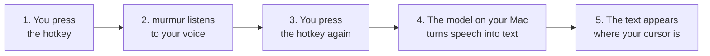

# murmur

murmur is a push-to-talk dictation app for macOS. It runs a speech model on your Mac. No audio leaves your computer.

Press a hotkey. Speak. Press the hotkey again. The app pastes the text at your cursor.

## How it works



More diagrams: [docs/ARCHITECTURE.md](docs/ARCHITECTURE.md).

## Speed

murmur is fast on low-end hardware. We tested it on a base MacBook Air M1 with 8 GB of RAM.

| Item | Value |
|---|---|
| Machine | MacBook Air (M1, 2020), 8 GB RAM, macOS 26.7.2, mains power |
| Software | murmur 0.1, whisper.cpp 1.7.5, `base.en` model, Metal GPU |
| Date | 2026-10-11 |

Time from the end of your speech to the finished text. We ran each clip 5 times.

| Speech length | Words | Time (median) | Range | Faster than real time |
|---|---|---|---|---|
| 2.5 s | 9 | **205 ms** | 198 to 213 ms | 12 times |
| 7.3 s | 26 | **307 ms** | 304 to 312 ms | 24 times |
| 20.9 s | 78 | **616 ms** | 573 to 657 ms | 34 times |

| Resource | Value |
|---|---|
| Memory while idle | about 210 MB |
| Memory peak while transcribing | 238 to 250 MB |
| CPU while idle | 0.0 % |
| Model load at launch | 130 to 230 ms (one time) |
| App size | 146 MB (zip: 129 MB) |

murmur does not record and does not run the model when you are idle.

Limits of this test:

- The word count matched the script on all 3 clips. This is not a full accuracy test.
- The clips use a synthetic macOS voice. Real speech, noise and accents can change the accuracy.
- The numbers cover the model only. We did not measure microphone launch or paste time.
- We tested one machine on mains power. We did not test battery use.

Run the test yourself with `./build.sh` and then `scripts/benchmark.sh`. More detail: [docs/PERFORMANCE.md](docs/PERFORMANCE.md).

## Install

You need an Apple Silicon Mac with macOS 14 or newer.

1. Download `murmur-0.1-arm64.zip` from the [Releases page](../../releases).
2. Unzip the file. Move `murmur.app` to Applications.
3. Right-click the app. Choose Open. Choose Open again.
4. Allow Microphone and Accessibility when macOS asks.

The app is not notarized. If macOS blocks it, run this command:

```
xattr -dr com.apple.quarantine /Applications/murmur.app
```

## Use

1. Click in a text field.
2. Press **Ctrl+Option+Space**. Speak.
3. Press **Ctrl+Option+Space** again.

A small pill shows the state: Listening (live voice bars), Transcribing, Pasted.

## Build from source

```
scripts/fetch-deps.sh
./build.sh
```

You need the Xcode Command Line Tools. You do not need full Xcode.

## More

- [Performance numbers](docs/PERFORMANCE.md)
- [Architecture diagrams](docs/ARCHITECTURE.md)
- [How we built it](docs/HOW_IT_WAS_BUILT.md)
- [Guide for AI agents](AGENTS.md)
- Speech model: [whisper.cpp](https://github.com/ggml-org/whisper.cpp), `base.en`. Hotkey: [KeyboardShortcuts](https://github.com/sindresorhus/KeyboardShortcuts). Licence: MIT.
