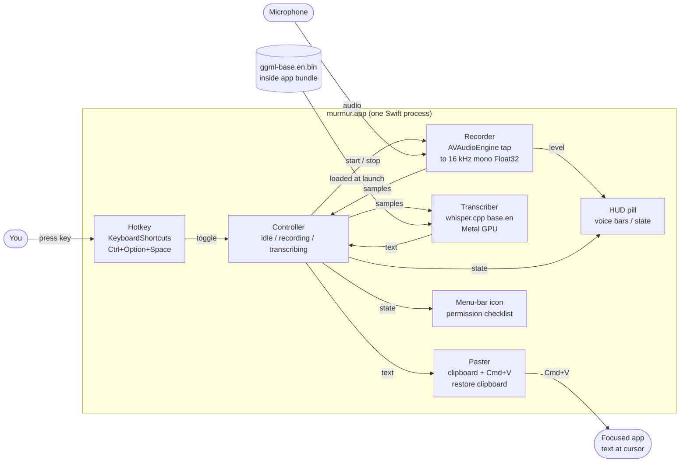

# murmur

murmur is a push-to-talk dictation app for macOS. It runs a speech model on your Mac. No audio leaves your computer.

Press a hotkey. Speak. Press the hotkey again. The app pastes the text at your cursor.

## How it works



More diagrams: [docs/ARCHITECTURE.md](docs/ARCHITECTURE.md).

## Install

You need an Apple Silicon Mac with macOS 14 or newer.

1. Download `murmur-0.1-arm64.zip` from the [Releases page](../../releases).
2. Unzip the file. Move `murmur.app` to Applications.
3. Right-click the app. Choose Open. Choose Open again.
4. Allow Microphone and Accessibility when macOS asks.

The app is not notarized. If macOS blocks it, run this command:

```
xattr -dr com.apple.quarantine /Applications/murmur.app
```

## Use

1. Click in a text field.
2. Press **Ctrl+Option+Space**. Speak.
3. Press **Ctrl+Option+Space** again.

A small pill shows the state: Listening (live voice bars), Transcribing, Pasted.

## Build from source

```
scripts/fetch-deps.sh
./build.sh
```

You need the Xcode Command Line Tools. You do not need full Xcode.

## More

- [Architecture diagrams](docs/ARCHITECTURE.md)
- [How we built it](docs/HOW_IT_WAS_BUILT.md)
- [Guide for AI agents](AGENTS.md)
- Speech model: [whisper.cpp](https://github.com/ggml-org/whisper.cpp), `base.en`. Hotkey: [KeyboardShortcuts](https://github.com/sindresorhus/KeyboardShortcuts). Licence: MIT.
